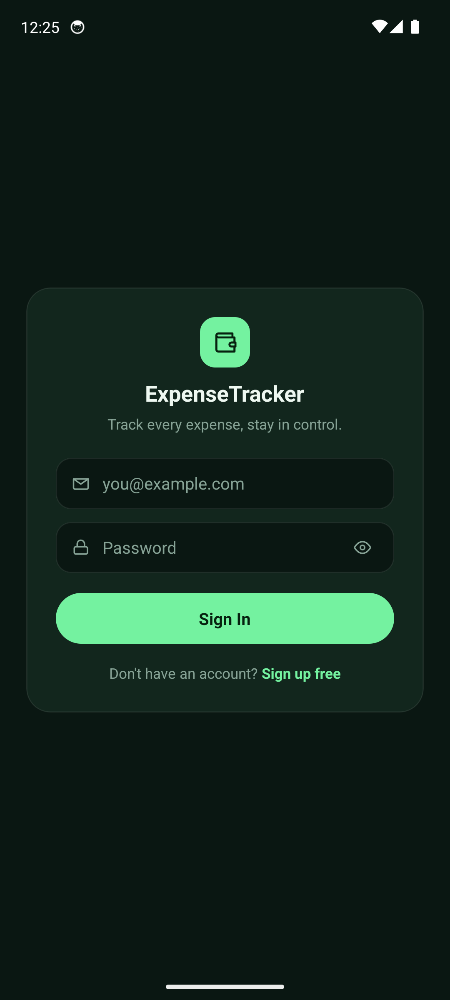
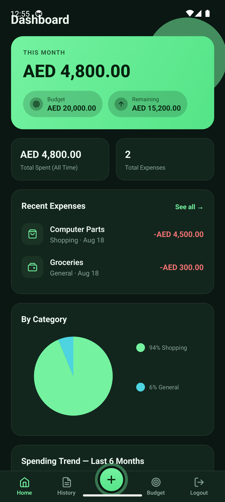
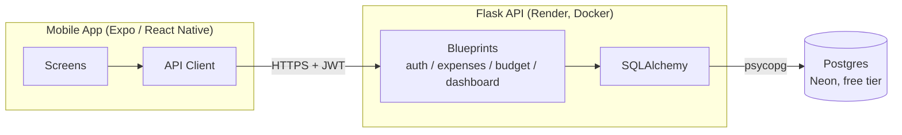

# Expense Tracker

[](https://github.com/DondieGatan/expense-tracker/actions/workflows/ci.yml)

A personal expense tracker: a **Flask** REST API (Python, SQLAlchemy, Postgres) with a **React Native**
(Expo, TypeScript) client that runs as an installable Android APK and as a web app, with budget tracking,
dashboard charts, per-user currencies and CSV export on top of full CRUD.

[](https://dondiegatan.github.io/dondiegatan-portfolio/projects.html#expense-tracker)

| Login | Dashboard |
|---|---|
|  |  |

**Live web app:** https://expense-tracker-web-rosy.vercel.app ·
[Demo video on my portfolio](https://dondiegatan.github.io/dondiegatan-portfolio/projects.html#expense-tracker) · built by
[Dondie Godwin Gatan](https://dondiegatan.github.io/dondiegatan-portfolio/)

**Try it in a minute:** open the live app, tap *Sign up*, and create a free account (no email confirmation, you are
signed straight in). Then use the green **+** button to add an expense: the quick-add chips (Coffee, Lunch, Fuel...)
fill in the category for you. Watch the dashboard and charts update, then set a monthly budget.

The backend ([expense-tracker-api-hlyz.onrender.com](https://expense-tracker-api-hlyz.onrender.com)) is on Render's
free tier, so the first request after about 15 minutes idle can take 30-50 seconds to wake up. The app retries with
a "waking up the server" message instead of failing, and a logged-out visitor reaches the login screen immediately
because that path does not depend on the backend being awake.

## Architecture



The database started on Azure SQL and later moved to Neon Postgres (the Azure SQL server was decommissioned);
the API on Render, the web client on Vercel and the database on Neon are three separate providers.

**A lesson from the Azure SQL days:** the first Azure SQL Database was provisioned in the region closest to where the
app was being built (UAE), not where Render actually runs its servers (Oregon, US). Every connection attempt from the
backend hit a login timeout, while connecting from a local machine worked fine. It looked like a firewall problem
at first (and a genuine firewall gap was fixed along the way), but a temporary raw-TCP-connect diagnostic route on the
backend proved the network path was fine in under 20 ms. The real fix was moving the database next to Render's
servers. Region choice matters when compute and data live on different providers.

## Features

- **Accounts** — register/login with short-lived JWT access tokens, long-lived
  refresh tokens, and server-side revocation on logout (a DB-backed blocklist,
  not just deleting the token client-side); every user only ever sees their
  own data, enforced at the query level
- **Log expenses** — description, amount, category, date, and payment
  method, with server-side validation
- **Edit / delete** any logged expense
- **Search and filter** the expense list by description, category, and date
  range, in any combination
- **Monthly budget** — set a spending limit and track it against the
  current month's spending
- **Dashboard** — total spent, this month's total, expense count, a
  category-breakdown donut chart, and a 6-month spending trend chart
- **CSV export** of the expense list, respecting whatever filters are
  currently applied
- **Per-user currency** — 12 ISO 4217 codes, stored server-side and used for every amount shown across the app
- **Quick-add templates** — one tap fills in a common expense (Coffee, Lunch, Groceries, Fuel, Taxi) with the right
  category
- **Forgot-password flow** — a SendGrid-emailed one-time code, hashed and single-use on the server, with no account
  enumeration
- **Light/dark theme** with a persisted preference, animated charts, swipe-to-delete on native (a dedicated delete
  action on web), pull-to-refresh and haptic feedback
- **Three ways to run it** from one codebase: a real Android APK built with EAS, the Expo web build on Vercel, and
  Expo Go for development

## Project layout

```
backend/    Flask REST API (SQLAlchemy models, JWT auth, blueprints per resource)
mobile/     React Native (Expo) app that consumes the API
```

## Data model

A `User` (`id`, `fullName`, `email`, `passwordHash`), an `Expense`
(`id`, `userId`, `description`, `amount`, `category`, `date`,
`paymentMethod`, `notes`), and a per-user `Budget` (`id`, `userId`,
`monthlyLimit`) — managed through Flask-Migrate/Alembic migrations against
Postgres (migrations run automatically on startup, see `app/__init__.py`).

## API reference

All endpoints are prefixed with `/api` and (except `/health`, `/auth/register`,
`/auth/login`, `/auth/refresh`) require `Authorization: Bearer <accessToken>`.

| Method | Path | Description |
|---|---|---|
| GET | `/health` | Liveness check |
| POST | `/auth/register` | Create an account, returns access + refresh tokens |
| POST | `/auth/login` | Returns access + refresh tokens |
| POST | `/auth/refresh` | Exchange a refresh token for a new access token |
| POST | `/auth/logout` | Revoke the current access token (and refresh token, if provided) |
| GET | `/auth/me` | Current user |
| GET | `/expenses` | List expenses (filters: `category`, `q`, `from`, `to`) |
| GET | `/expenses/export` | CSV export of the same filtered list |
| GET | `/expenses/categories` | Available categories + payment methods |
| GET/POST | `/expenses/:id` | Get / create an expense |
| PUT/DELETE | `/expenses/:id` | Update / delete an expense |
| GET/PUT | `/budget` | Get / set the monthly budget |
| GET | `/dashboard` | Aggregated totals, category breakdown, 6-month trend |

## Run the backend

Requires Python 3 and a database. Set `DATABASE_URL` to any Postgres connection string (a free
[Neon](https://neon.tech) project works well). If `DATABASE_URL` is not set, the backend falls back to a local SQL
Server instance (`localhost\SQLEXPRESS` with Windows authentication, overridable through the `SQL_SERVER` /
`SQL_DATABASE` / `SQL_DRIVER` / `SQL_USERNAME` / `SQL_PASSWORD` variables), which needs the ODBC driver installed.

Other environment variables: `SECRET_KEY` and `JWT_SECRET_KEY` (always set real values in production),
`CORS_ORIGINS` (comma-separated allowlist for browser clients), and optionally `SENDGRID_API_KEY` / `SENDGRID_FROM`
for password-reset email.

```bash
cd backend
python -m venv venv
venv/Scripts/activate       # or source venv/bin/activate on macOS/Linux
pip install -r requirements.txt
flask db upgrade            # apply migrations
python run.py                # serves on http://localhost:5100
```

## Run the mobile app

Requires Node.js.

```bash
cd mobile
npm install
npx expo start --web         # or --android / --ios
```

The app talks to the API at `http://localhost:5100/api` by default (or
`10.0.2.2` on the Android emulator). Set `EXPO_PUBLIC_API_URL` to point at a
deployed backend instead — see `mobile/src/api/client.ts`.

## Deployment

- **Backend**: Docker image on Render (`backend/Dockerfile`, `python:3.12-slim-bookworm`), served by gunicorn.
  Render's native Python runtime has no `apt` access, so the image is still built through Docker even though
  production no longer needs the ODBC driver stack that used to live there (`psycopg[binary]` bundles its own
  `libpq`). Migrations run inside `create_app()` itself rather than as a separate step, because Render's free tier
  has no pre-deploy command and a second cold-start cycle would slow every wake-up.
- **Database**: Neon Postgres (free tier).
- **Web**: the Expo web build is deployed on Vercel and talks to the same Flask API through a locked-down CORS
  allowlist.
- **Mobile**: standalone Android APK via `eas build --platform android --profile preview`, distributed directly
  rather than through the Play Store. `mobile/eas.json` defines the build profile and bakes in the production
  `EXPO_PUBLIC_API_URL` at build time.

## Tests

```bash
cd backend
python -m pytest
```

The suite covers auth, CRUD, category/search/date filtering, budget
calculations, dashboard aggregation, CSV export, and cross-user data
isolation, using SQLite in-memory so no real database connection is
required to run it. CI runs the same command on every push via GitHub
Actions, alongside a TypeScript check for the mobile app.

## Stack

**Backend**: Python · Flask · SQLAlchemy · Flask-Migrate · Flask-JWT-Extended · Flask-Limiter · Postgres (`psycopg`)
· SendGrid · pytest · gunicorn · Docker

**Mobile / web**: React Native · Expo · TypeScript · React Navigation · react-native-chart-kit ·
react-native-reanimated

**Infra**: Render (API) · Vercel (web build) · Neon (Postgres) · EAS Build (Android APK) · GitHub Actions (CI)
